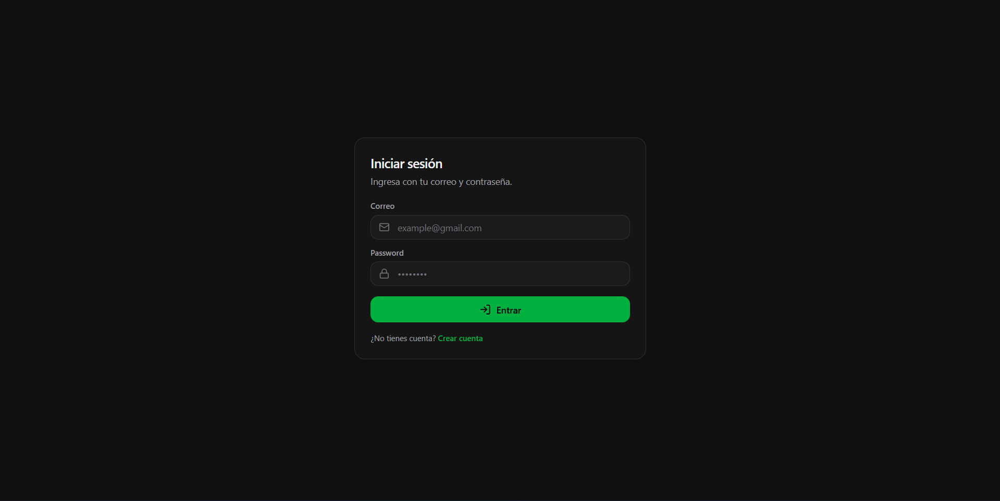
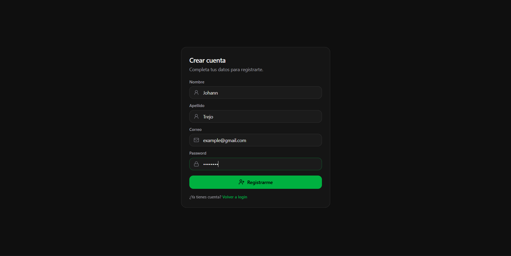
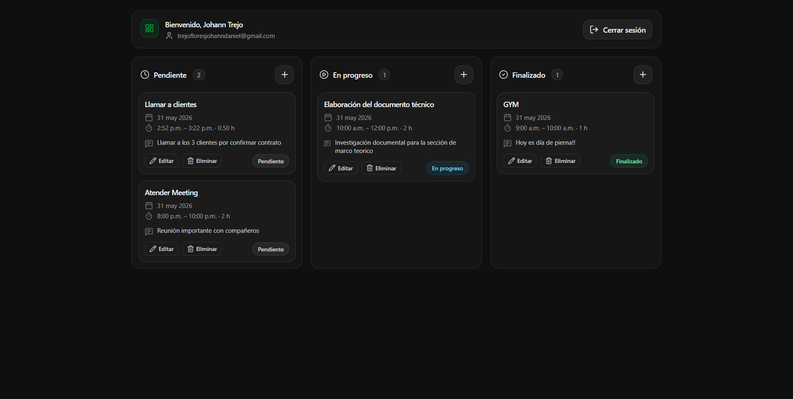

<p align="center">
    <h1 align="center">Agenda</h1>
</p>
<p align="center">
    <em>Personal activity management app with a Kanban board</em>
</p>

<p align="center">
    
    
    
    
    
    
    
    
    
</p>
<hr>

## 🚀 Getting Started

### Prerequisites

**Backend:**
- Java 21+
- Docker & Docker Compose
- Gradle (or use the included wrapper)

**Frontend:**
- Node.js 18+

---

### Backend Setup

1. Clone the repository:
```bash
git clone https://github.com/Nu11Man777/Agenda.git
cd Agenda/backend
```

2. Create your `.env` from the example:
```bash
cp .env.example .env
```
Edit `.env` and fill in your credentials (see `.env.example` for all required variables).

3. Start the Oracle XE database:
```bash
docker-compose up -d
```

4. Run the backend:
```bash
./gradlew bootRun
```

API available at `http://localhost:8080`

---

### Frontend Setup

1. Navigate to the frontend directory:
```bash
cd Agenda/frontend
```

2. Install dependencies:
```bash
npm install
```

3. Create your `.env.local`:
```env
VITE_API_URL=http://localhost:8080
```

4. Start the dev server:
```bash
npm run dev
```

App available at `http://localhost:5173`

---

## 📸 Screenshots

### Authentication
<p align="center">
  
</p>
<p align="center">
  
</p>

### Kanban Board
<p align="center">
  
</p>

---

## 🔒 Security testing

This repo includes small, opt-in mechanisms for controlled CI/CD security

---

## 🤟 Contributors

<table>
  <tr>
    <td align="center">
      <a href="https://github.com/Nu11Man777">
        <br />
        <sub><b>Johann Trejo Flores</b></sub>
      </a><br />
    </td>
  </tr>
</table>
